# DevDeck on Windows

The Windows shell is a WPF client for protocol v2. `DevDeckEngineHost` owns all product decisions
and state. The shell reports displays and user interaction, applies panel frames, draws card models
and returns commands without changing their JSON.

## Build and test

Windows 11 22H2 or later, Swift 6.4 and the .NET 10 SDK are required.

```powershell
swift build --jobs 1
dotnet build Windows/DevDeck.Windows.slnx --configuration Release -warnaserror
dotnet run --project Windows/DevDeck.Shell.Tests --configuration Release --no-build
Tools/Build-WindowsShell.ps1
```

The build script writes a framework dependent package to `dist/windows-<architecture>`. It defaults
to the machine architecture and accepts `-Architecture x64` or `-Architecture arm64`. The package
contains the shell, the engine host, the process host and Swift runtime libraries. Test assemblies are excluded.
The shell requires .NET 10 Desktop Runtime, supplied separately by Microsoft.

## ARM64

Native ARM64 builds require an ARM64 Swift 6.x toolchain, the Visual Studio 2022 ARM64 C++ tools,
the Windows 11 SDK and the ARM64 .NET 10 SDK. SwiftPM creates convenience symbolic links below
`.build`, so enable Windows Developer Mode or grant the user permission to create symbolic links
before running the warning-free build. Build the delivery and installer with:

```powershell
pwsh -NoProfile -File Tools/Build-WindowsShell.ps1 -Architecture arm64
pwsh -NoProfile -File Tools/Build-WindowsInstaller.ps1 -Architecture arm64
```

The commands write `dist/windows-arm64` and
`dist/DevDeck-<version>-windows-arm64-setup.exe`. The x64 installer is restricted to x64 Windows
and refuses to install on ARM64 now that the native package exists; an x64 copy already running
under emulation on an ARM64 machine picks the native installer at its next update, because the
engine asks the machine's architecture rather than its own. Use the Windows ARM64 edition
of Docker Desktop and enable its integration for the WSL distribution that runs projects.

## Install

GitHub releases include `DevDeck-<version>-<build>-windows-setup.exe`,
`DevDeck-<version>-<build>-windows-arm64-setup.exe` and matching `.exe.sha256` files. The build
number is the tagged commit count, shared with the Mac archive. The release workflow tests Mac,
Windows x64 and Windows ARM64 before publishing the installers. A manual run with
`attach=false` keeps its packages as Actions artifacts and leaves the release files and notes alone.
It builds the dispatched branch commit so an older tag can label the check without supplying old
source. Published releases and manual runs with `attach=true` build the tag itself.

Install Inno Setup 6 with `winget install JRSoftware.InnoSetup`, then build:

```powershell
pwsh -NoProfile -File Tools/Build-WindowsInstaller.ps1
```

The wrapper reads the same root `VERSION` file as the Mac build. Its default architecture is the
machine architecture; `-Architecture x64` keeps the existing
`dist/DevDeck-<version>-windows-setup.exe` name and `-Architecture arm64` writes the ARM64 name
shown above. `-OutputDirectory` accepts only a directory inside the repository. ISCC is found in
the per-user installation, Program Files (x86), or PATH.

Setup installs for the current user under `%LOCALAPPDATA%\Programs\DevDeck`, creates a Start
Menu shortcut with AUMID `DevDeck.Shell`, and registers uninstall in HKCU. It creates no desktop
shortcut and does not enable Start at login. A matching installer shortcut is kept by the shell.

If .NET 10 Desktop Runtime is missing, setup downloads the runtime that matches the installer
architecture from Microsoft's permanent link and runs `/install /quiet /norestart`. Only this runtime step needs UAC approval;
DevDeck itself needs no administrator rights. Download failures show the download link and stop
installation with an explanation. The permanent link changes with servicing releases, so a
fixed checksum is not pinned.

The beta is unsigned, as recorded in [ADR 0035](../docs/adr/0035-windows-delivery.md).
SmartScreen can warn because the publisher has no signing identity or established reputation.
For a copy you downloaded from this repository and intended to install, choose **More info**,
then **Run anyway**.

Setup asks a running shell to quit through `DevDeck.Shell.exe --quit` and waits up to ten
seconds. The shell stops its host through the usual asynchronous cleanup; detached project
processes keep running. Older builds without this argument must first be closed using Quit
in the tray. Setup explains this instead of forcefully terminating them.

Restart Manager only targets the shell and engine host. Detached project hosts are excluded.
Setup compares the packaged DLLs and process host with installed SHA256 digests and keeps
identical files, so running projects can keep using them during a shell update. An update
that replaces a loaded project host or runtime can still encounter locked files. Stop those
projects before installing a delivery with changed runtime binaries.

Silent installation uses `/VERYSILENT /SUPPRESSMSGBOXES /NORESTART /CLOSEAPPLICATIONS` and
starts DevDeck after completion. `/NORESTARTAPP` prevents that launch. Interactive installation
has a checked Start DevDeck option on the final page. Updating installs in the same directory,
leaves preferences and credentials intact and preserves an existing Start at login entry
pointing to that directory.

Uninstall closes the shell and removes installed files, the Start Menu shortcut, the current
user's `DevDeck` Run value and `%PROGRAMDATA%\DevDeck\NotificationAssets`. It preserves
`%LOCALAPPDATA%\DevDeck`, `%APPDATA%\DevDeck` and Credential Manager secrets. It leaves the
shared .NET runtime installed. The removal confirmation states that settings and secrets remain.

The [W-15 verification report](../docs/windows/W15-windows-installer-report.md) records sizes,
live installation checks, screenshots and the cases not checked on this machine.

## Updates

The engine offers a Windows installer only when its release also contains a `.sha256` file.
Clicking Update Now makes the shell download both files to
`%LOCALAPPDATA%\DevDeck\Updates\<version>`. Downloads follow HTTP redirects and overwrite the
previous attempt. The shell reports received bytes relative to the asset size, at most once
every 100 ms. The engine supplies the update row, its words and whether its button is enabled.

The first word of the checksum file's first nonempty line must be a 64 character SHA256 hash.
The comparison ignores letter case. A missing checksum stops the attempt; a mismatched hash
removes the downloaded installer and reports `checksum mismatch`. Nothing is launched in either
case. Download and launch failures return `update.failed`, which the engine puts in its row.

After verification the shell reports `update.installing` and launches the installer with
`/VERYSILENT /SUPPRESSMSGBOXES /NORESTART /CLOSEAPPLICATIONS`. It does not wait for the process.
The installer uses `--quit` to close the old shell, updates the per-user installation and starts
the new copy. Preferences and card positions stay in place. If the old shell is still alive
after 60 seconds, it reports that the installer did not finish, with the release page address.
The verified file stays available; the next attempt downloads it again.

The beta verifies the downloaded file against its release checksum and does not verify a
signature. See [the delivery decision](../docs/adr/0035-windows-delivery.md) and
[the update verification report](../docs/windows/W17-windows-update-report.md).

## Deterministic replay

Replay reads protocol events from a golden transcript instead of starting the engine and reads
no token. It carries out every effect except `quit`: a replay exists
to be looked at, so a `quit` in the transcript is noted on standard error and the windows stay
until they are closed by hand. With no engine to answer, a replay also sizes its own panels: a
card takes the height the shell measured and the cards below it in its column move with it. The
banner transcripts raise real Windows notifications, which appear as banners only while Windows'
Do not disturb is off; with it on they go straight to the notification centre.

An `installUpdate` fixture with a checksum URL downloads and runs that installer, so use a
local test server for update checks. `--trace` records incoming replay events and outgoing
intents. Replay also accepts a streaming named pipe: a local harness can forward those intents
to the engine and return its events while the shell stays responsive. This keeps progress and
failure words in the engine during live update checks.

```powershell
dotnet run --project Windows/DevDeck.Shell -r win-x64 -- --replay Tests/EngineTests/Golden/session-en.expected.jsonl
dotnet run --project Windows/DevDeck.Shell -r win-x64 -- --replay Tests/EngineTests/Golden/session-ru.expected.jsonl
dotnet run --project Windows/DevDeck.Shell -r win-x64 -- --replay Tests/EngineTests/Golden/runtime-menu-en.expected.jsonl
dotnet run --project Windows/DevDeck.Shell -r win-x64 -- --replay Tests/EngineTests/Golden/runtime-menu-ru.expected.jsonl
dotnet run --project Windows/DevDeck.Shell -r win-x64 -- --replay Tests/EngineTests/Golden/runtime-banners-en.expected.jsonl
dotnet run --project Windows/DevDeck.Shell -r win-x64 -- --replay Tests/EngineTests/Golden/runtime-banners-ru.expected.jsonl
dotnet run --project Windows/DevDeck.Shell -r win-x64 -- --replay Tests/EngineTests/Golden/session-settings-en.expected.jsonl
```

Screenshots must use these neutral golden sessions.

English replay:

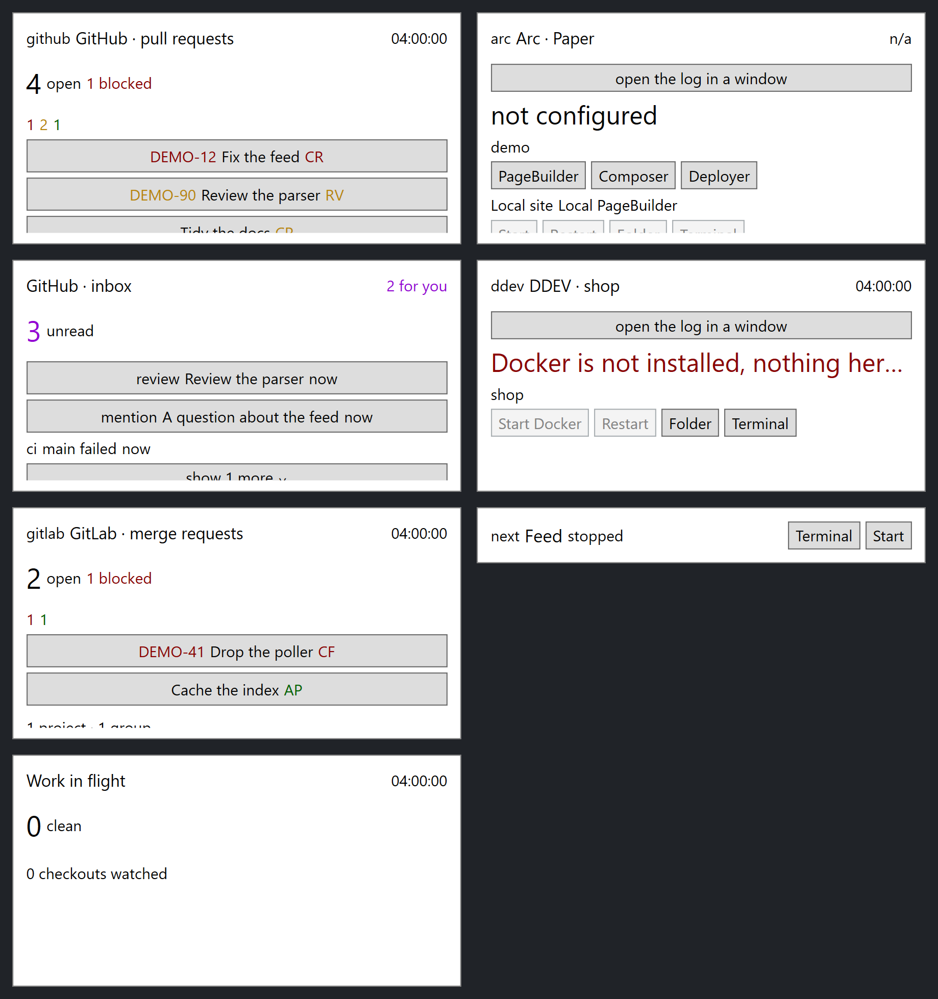

Russian replay:

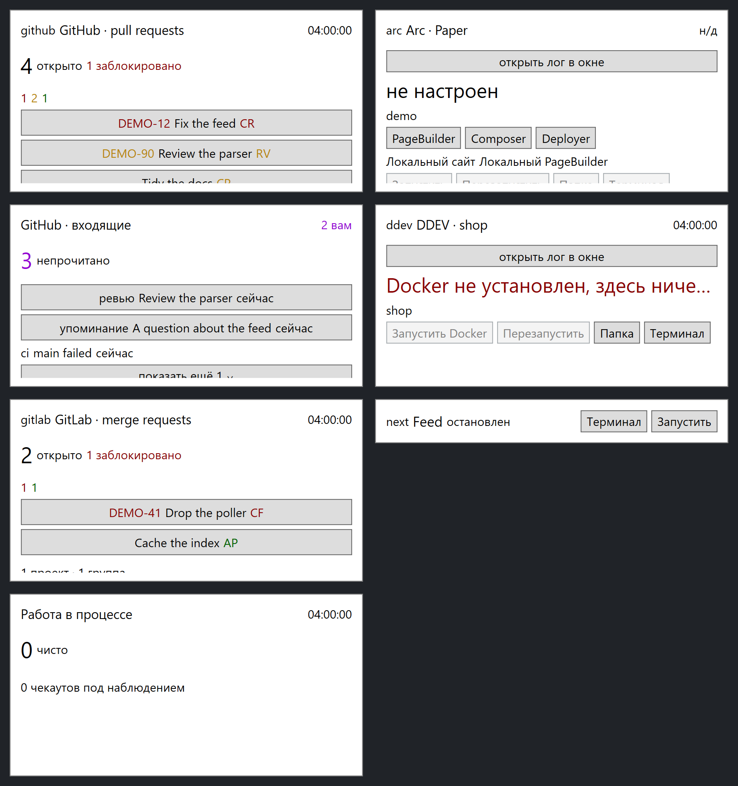

The style reference replay uses the final GitHub review model and the plain project model from
the English golden session. It adds only the engine-owned `meta.place` values needed to show the
Windows and WSL variants:

```powershell
dotnet run --project Windows/DevDeck.Shell -r win-x64 -- --replay docs/windows/ui/windows-style-sample.jsonl
```

The left side of each comparison is the accepted HTML mock. The right side is the WPF renderer
at the same scale. Both sides draw cards at 352 device-independent pixels with 16 pixel side
padding, 14 pixel top and bottom padding, a 20 pixel header, 30 pixel list rows and the typography
specified in `docs/windows-style.md`:


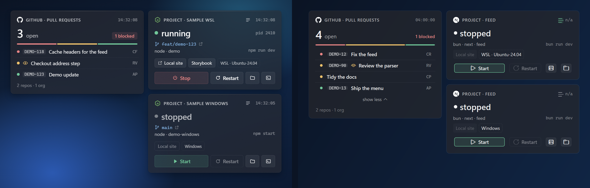


Live Acrylic and the solid fallback use the same neutral replay data:

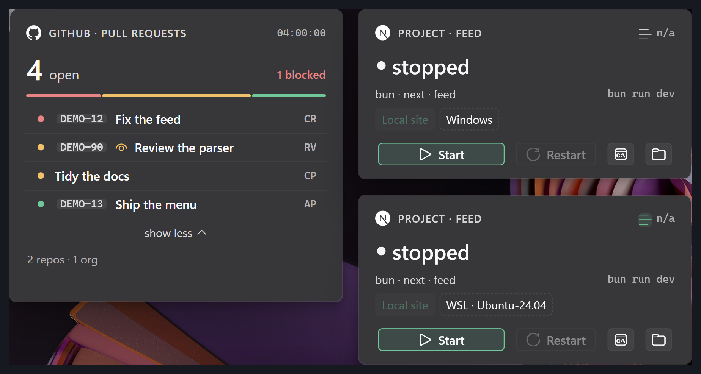

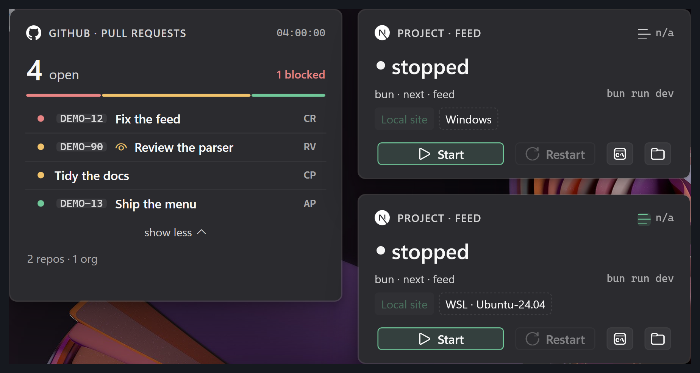

The W-4 captures contain every distinct state supplied by the English golden session. Each file
keeps one card kind together so it can be compared with the matching Mac capture on the same
data:

| Card | Windows capture |
|---|---|
| GitHub pull requests | [w4-github-pull-requests.png](../docs/windows/ui/w4-github-pull-requests.png) |
| GitHub inbox | [w4-github-inbox.png](../docs/windows/ui/w4-github-inbox.png) |
| GitHub Actions | [w4-github-actions.png](../docs/windows/ui/w4-github-actions.png) |
| GitLab merge requests | [w4-gitlab-merge-requests.png](../docs/windows/ui/w4-gitlab-merge-requests.png) |
| Work in flight | [w4-work-in-flight.png](../docs/windows/ui/w4-work-in-flight.png) |
| Arc project | [w4-arc-project.png](../docs/windows/ui/w4-arc-project.png) |
| DDEV project | [w4-ddev-project.png](../docs/windows/ui/w4-ddev-project.png) |
| Plain project | [w4-plain-project.png](../docs/windows/ui/w4-plain-project.png) |
| Collapsed cards | [w4-collapsed-cards.png](../docs/windows/ui/w4-collapsed-cards.png) |

The shared button template gives every control a two-stroke keyboard focus indicator and distinct
hover, pressed and disabled states. Each state is captured separately from the neutral golden
project card.

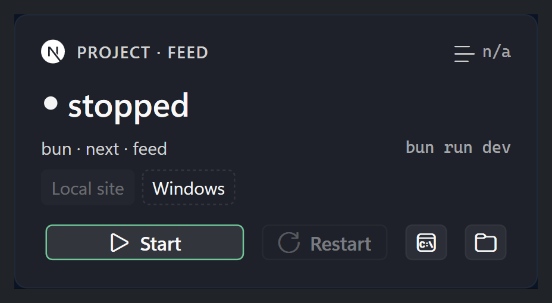

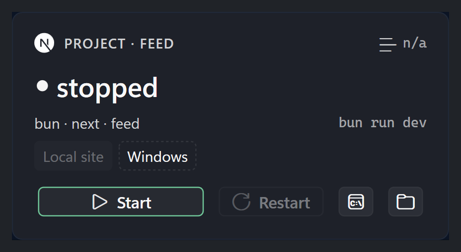

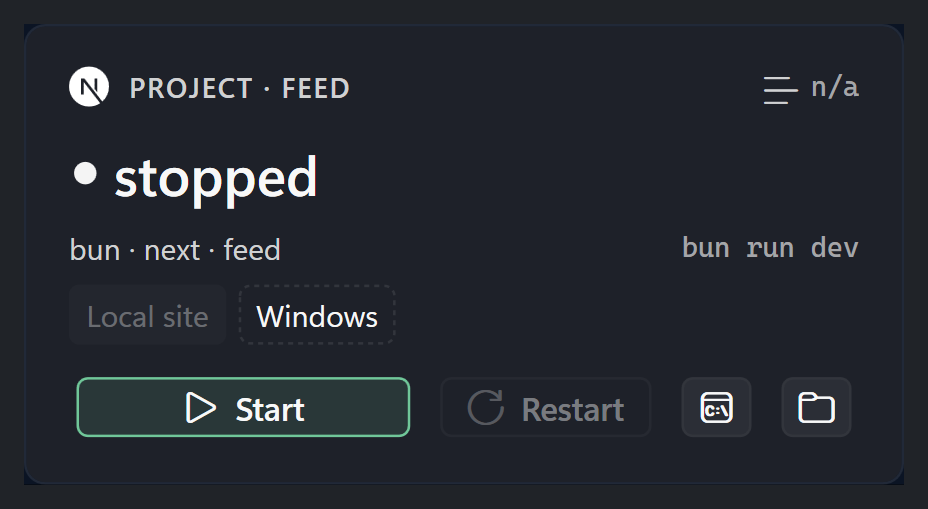

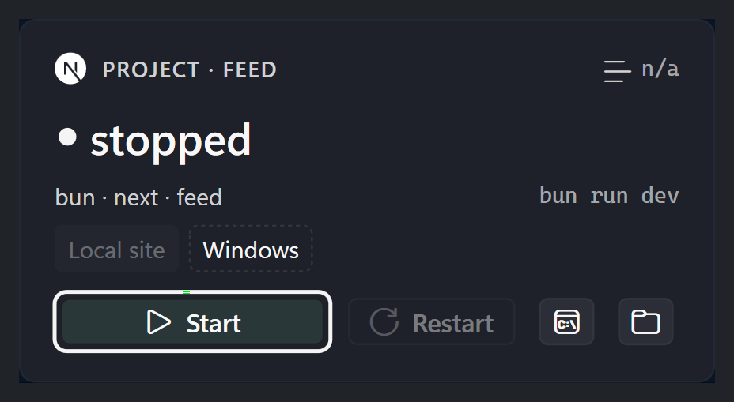

The runtime menu replays drive the same tray and menu renderer as the live host. The menu keeps
the engine supplied order, words, marks, attention tiers, alternates, checks and submenus. Card
menus use that renderer on right click. Confirmation and prompt dialogs also use only the words
in the menu model.

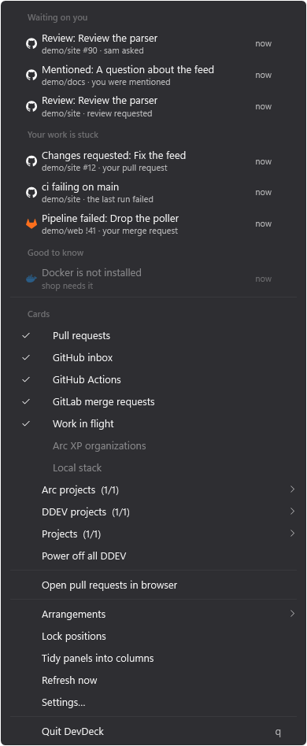

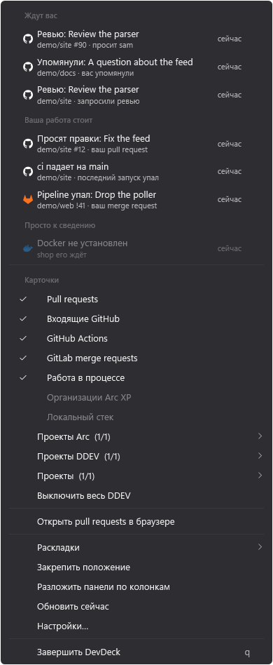

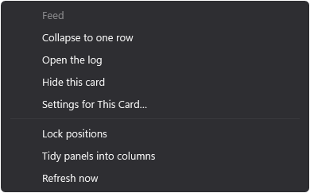

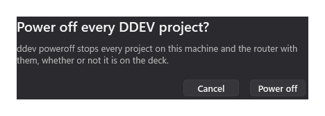

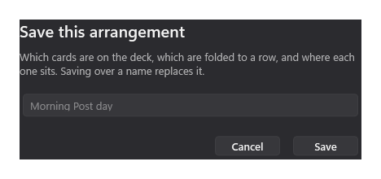

The tray mark has 16 and 32 pixel icon frames. It follows the taskbar theme and draws the engine
supplied tier. Tier 3 uses the calm mark because it does not ask for immediate action.

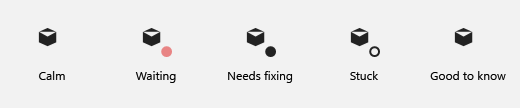

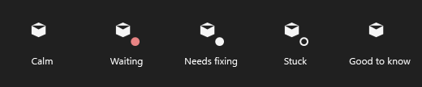

The shell posts every `notify` model as a Windows toast. The title, subtitle, body, quiet flag,
source mark and command come from the engine. Repeated ids stay quiet for the lifetime of the
shell, including engine restarts. The capture renderer below uses the same engine models and
shared vector marks; Windows supplies the final system chrome on the live toast.

This is a real Windows toast from the unpackaged shell, using neutral golden data:

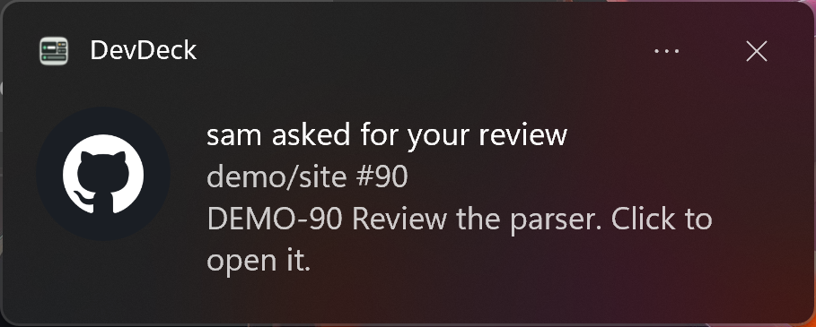

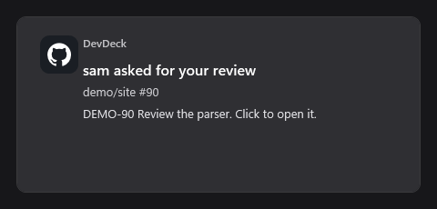

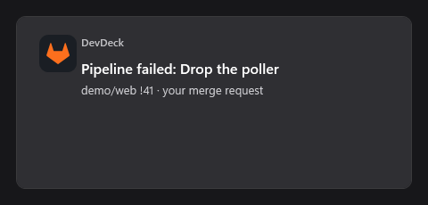

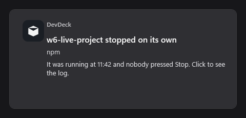

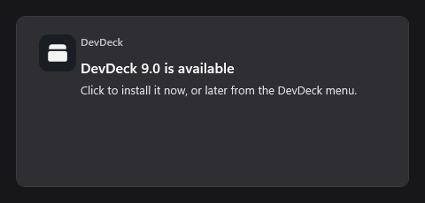

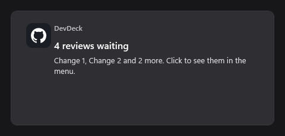

The project log opens in one normal Windows window per card. Its title, lines, source and empty
detail come from protocol v2. New tail lines are appended without rebuilding the existing visual
rows. The view follows the end until it is scrolled up, and Ctrl+F filters and highlights matches.
Window size and position are kept in `%LOCALAPPDATA%\DevDeck\shell-log-windows.json`.

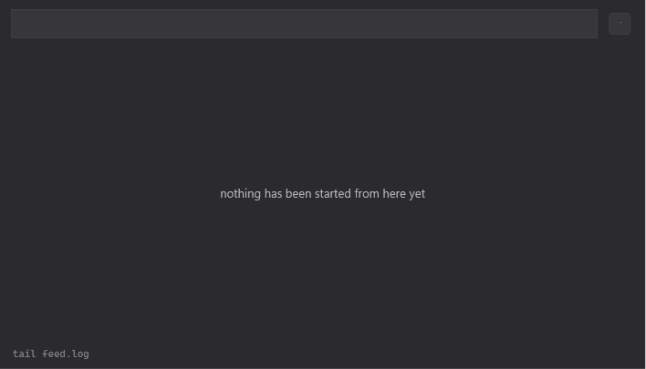

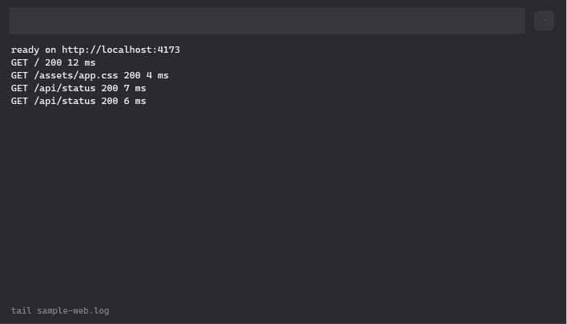

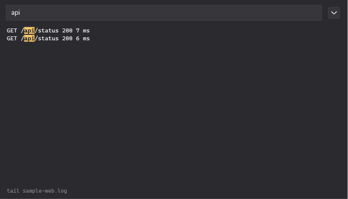

## Toast registration

The unpackaged shell uses the classic Windows toast API with the stable AUMID `DevDeck.Shell`.
At startup it keeps a matching installer shortcut, or creates or updates the current user's
`%APPDATA%\Microsoft\Windows\Start Menu\Programs\DevDeck.lnk`, points it at the running
executable and gives it the same AUMID. Windows uses that shortcut to associate notifications
with DevDeck. Activation is handled only while the shell is running, so the exact command stays
in memory and is never written to an activation argument.

Source marks are rendered as square 256 pixel PNG files in
`%PROGRAMDATA%\DevDeck\NotificationAssets`. That location lets the Windows notification renderer
read the image. The XML uses an absolute `file:///C:\...` source. The executable embeds the
DevDeck app icon, which is also used by the Start Menu shortcut and the toast header.
The shortcut and notification asset directory are the only persistent machine state created for
notifications.

The earlier Windows App SDK 1.8 implementation called `AppNotificationManager.Register()` and
reported notifications as enabled, but Windows Shell did not display or retain them. This matches
[Windows App SDK issue 6821](https://github.com/microsoft/WindowsAppSDK/issues/6821). The classic
API and Start Menu shortcut work for both `dotnet run` and the framework dependent output of
`Tools/Build-WindowsShell.ps1`.

## Backdrop behavior

The Windows 11 test confirms that a borderless WPF window receives the system backdrop when
`AllowsTransparency` stays false. DevDeck extends the DWM frame through the whole client area,
keeps the WPF composition target transparent, sets `DWMWA_SYSTEMBACKDROP_TYPE` to
`DWMSBT_TRANSIENTWINDOW`, opts into dark mode and asks DWM for rounded corners. On the tested
machine DWM returned backdrop value `3`, dark mode value `1` and corner preference value `2`.

The card surface adds the specified `#28282C` tint at 66 percent opacity. When Windows transparency
effects are off, it switches to the opaque `#2B2B2F` surface. The shell still leaves corner
clipping to DWM, so neither mode produces square corner artifacts.

## Live development

Run the shell against a locally built host:

```powershell
dotnet run --project Windows/DevDeck.Shell -r win-x64 -- --engine .build\out\Products\Debug-windows-x86_64\DevDeckEngineHost.exe
```

The development commands add and remove a local project through the engine settings operation and
print the matching protocol answer:

```powershell
dotnet run --project Windows/DevDeck.Shell -- --add-project C:\projects\sample-api
dotnet run --project Windows/DevDeck.Shell -- --add-project \\wsl.localhost\Ubuntu-24.04\home\developer\sample-web
dotnet run --project Windows/DevDeck.Shell -- --remove-project project.sample-api
```

`--trace <file>` appends every protocol line to a file, each with a timestamp and `<` for the
host's lines or `>` for the shell's. A settings request that carries a typed token is replaced
by a note, so no token reaches the file. It is a developer flag for questions about timing,
such as which `panels.changed` came before a card overlapped another.

```powershell
dotnet run --project Windows/DevDeck.Shell -r win-x64 -- --trace C:	emp\devdeck-trace.jsonl
```

The host stores tokens in Windows Credential Manager. The shell contains no token storage code and
never reads a token.

## Displays and coordinates

The shell sends monitor work areas, panel measurements and panel frames in one virtual desktop
coordinate system. Its unit is a DIP on the primary monitor, with the origin at the virtual
desktop's primary monitor and y increasing downward. Windows reports monitor work areas in
physical pixels, so the shell divides every coordinate by the primary monitor scale at the
protocol boundary. A
panel on another monitor still renders with that monitor's scale because the manifest selects Per
Monitor V2 awareness. The reverse conversion happens once when the shell applies a frame from the
engine.

After applying a native panel frame and after `WM_DPICHANGED`, the shell recalculates the WPF
window size from primary monitor DIPs and the window's current DPI. The native frame and WPF
layout therefore stay at 352 local DIPs when a panel moves between displays with different scales.

Each display id is the monitor device interface path returned by Windows. That path follows the
physical monitor across disconnects and reconnects, unlike names such as `DISPLAY1`. The reported
frame excludes the taskbar and other app bars, and exactly one connected display is primary.

The shell sends the complete display list after `WM_DISPLAYCHANGE`, a work area
`WM_SETTINGCHANGE`, a panel `WM_DPICHANGED`, and resume from sleep. It reports one final
`card.moved` after an unlocked user drag. Window moves caused by `panels.changed` are suppressed,
while other Windows initiated moves are reported after the corresponding display event when one
is available. The engine owns the settling delay, parking, restoring and Tidy placement.

The live check used a 250 percent primary display and a 100 percent external display. Two cards
were dragged to the external display, aligned there with Tidy, and restored there after restarting
the shell. Disconnecting the external display parked both cards in a free column on the primary
display at the primary scale. Reconnecting it restored their previous positions. Sleep and resume
kept both stable display ids and all panel frames, without a move reported for the system shift.

These captures use the WPF renderer with neutral golden data. The connected capture presents both
display scales in one canvas. The disconnected capture shows the same two cards parked without
covering the cards already on the primary display.

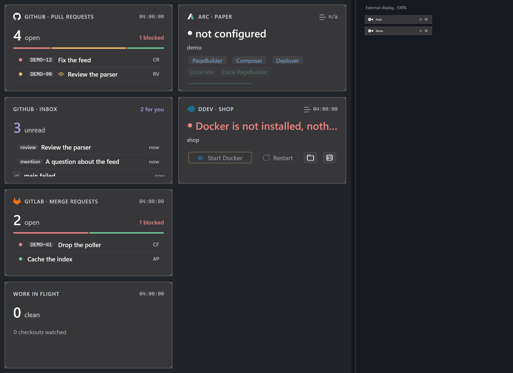

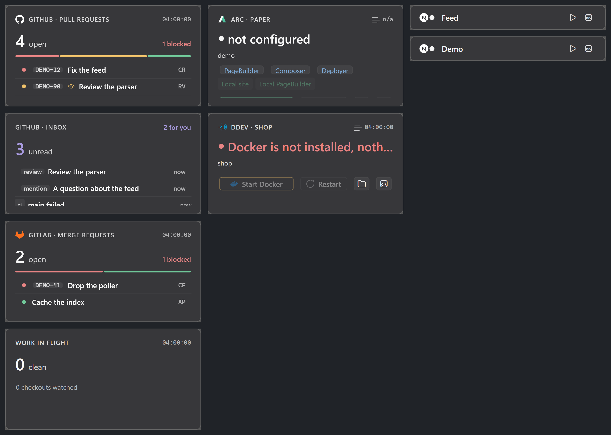

The DPI hotfix acceptance uses real full desktop captures from Snipping Tool with the golden
session models. The first capture shows three cards opened directly on the 100 percent external
display. The second shows the Work in Flight card after a live drag from the 250 percent primary
display to the external display. Each card keeps a 352 DIP width and complete content at its local
scale.

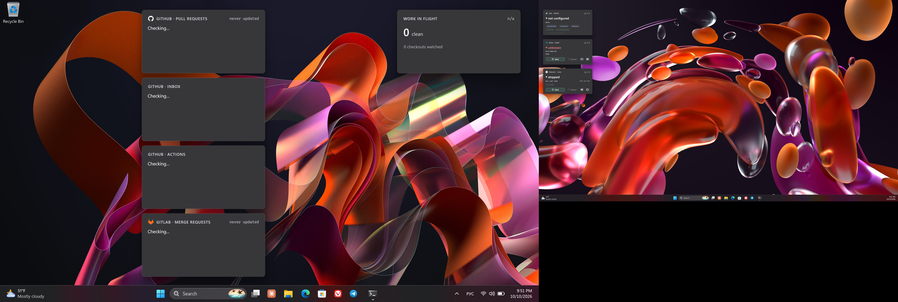

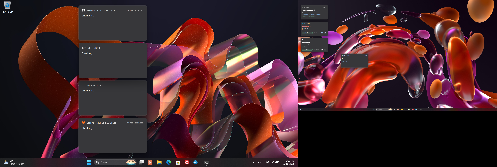

## Summon

The shell asks the engine for deck preferences when a session starts and after every preferences
answer. `summonEnabled` controls whether Summon can raise the deck, `summonDims` controls the
veils, and `summonShortcutWindows` supplies the global shortcut. A missing shortcut uses
`Ctrl+Shift+Space`. Windows reserves `Alt+Space` for the active window's system menu and most
Windows key combinations for the shell, so the default uses neither.

The shortcut is registered with `RegisterHotKey`. The shell does not install a keyboard hook and
does not choose another shortcut when registration fails. It writes the Windows error to standard
error and keeps running. `GetAsyncKeyState` observes release of the shortcut's main key because
`WM_HOTKEY` reports only the press.

A press raises every card to the topmost layer. Releasing it after 0.25 seconds returns the cards
to the layer from `deck.displayMode`; a shorter tap keeps them raised until the next press, Escape
or a click on the dimmed area. The 0.25 second value mirrors
`DeckRuntime.summonLatchThreshold` until the protocol carries it. The `present` effect uses the
same latched state.

When dimming is enabled, each raise creates one nonactivating black window at 30 percent opacity
for every monitor work area. The taskbar remains uncovered so Start and taskbar controls still
work. The veils are placed below the topmost cards and are discarded when Summon ends, so a new
raise uses the current monitor list.

The live check used a 250 percent primary display and a 100 percent external display. Both veils
matched their complete monitor work areas. The cards stayed above them without taking focus, and
Start and Alt+Tab continued to work. Escape returned all cards to their previous layer.

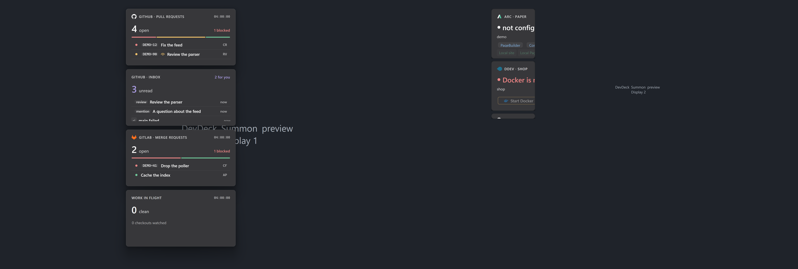

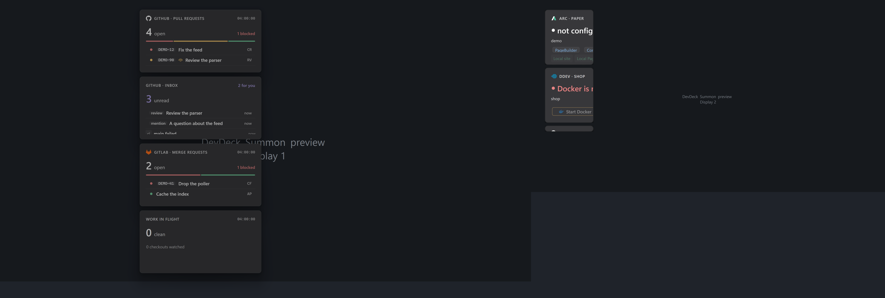


## Settings

The `openSettings` effect opens one reusable settings window. Its navigation, forms, status rows,
dialogs and controls use the `words`, `list`, `cards`, `preferences` and record answers from the engine.
Requests keep their protocol id until the matching `settings.answered` arrives, so a slow check
for one record cannot update another form. A preferences answer asks for `words` again because
the language may have changed.

The Cards page sends `setCard` and replaces its rows with the returned `cards` answer. A missing
Windows Summon shortcut displays `SummonShortcut.DefaultText`, while Default stores nil. Token
page links send `openGitHubTokenPage` or `openGitLabTokenPage`; the engine supplies the resulting
`openURL` effect.

The token field is a `PasswordBox`. Save moves its text into one `checkGitHubToken` or
`checkGitLabToken` request, clears both the control and its form buffer, and never reads the token
back. The engine continues to own Credential Manager storage. Project location labels use the
engine's `project.place.windows` and `project.place.wsl` words. The shell only extracts a WSL
distribution name from the UNC path.

Browser fields list applications registered under `SOFTWARE\Clients\StartMenuInternet` and
store that registry key as the protocol identifier.
Edge, Chrome, Brave and Vivaldi get a second profile picker from the browser's `Local State`
file in Local AppData. Firefox and other browsers have no profile picker. The replay source for
settings screenshots
is [`windows-settings-sample.jsonl`](../docs/windows/ui/windows-settings-sample.jsonl). It was
recorded from a live host in an isolated profile with neutral account and project names.

## Links, folders and the phone

An `openURL` effect with no browser uses the Windows default association. An explicit browser is
resolved from its Start Menu Internet registry entry. Chromium choices pass
`--profile-directory=<directory>` before the URL when the engine supplies a profile. The shell
keeps the Local State path table because Windows does not publish those vendor paths in the
registry. The table currently covers Edge, Chrome, Brave and Vivaldi.

`openTerminal` uses `wt.exe -d <folder>` for a Windows folder. Without Windows Terminal it opens
`cmd.exe /K cd /d <folder>`. A `\\wsl.localhost\<distribution>\...` or
`\\wsl$\<distribution>\...` folder becomes the Linux path seen by that distribution and opens
through `wt.exe wsl.exe -d <distribution> --cd <path>`, or directly through `wsl.exe` in a new
window when Windows Terminal is absent. `revealFolder` passes Windows and WSL paths to Explorer
unchanged.

The phone button creates its QR image locally with QRCoder 1.8.0, an MIT licensed dependency.
The popup contains only `phoneTitle`, `phoneNote` and `phoneURL` supplied by the engine. On
Windows, `LocalAddress.current()` reads IPv4 adapters through `GetAdaptersAddresses`, keeps active
physical adapters, prefers Wi-Fi and ignores loopback, Hyper-V, WSL, VPN and other virtual
adapters. Nothing is sent to a QR service.

## Agents

The General page has **Agents (MCP)** with an **MCP server** choice: Off, Read only, Read and control. While it is not Off the engine
host opens `\\.\pipe\DevDeck.Agent.<user>`, a pipe that refuses remote clients and whose access
list names the current user alone, and `DevDeckMCP.exe` beside the shell is the MCP server an
agent starts. The page shows the `claude mcp add --scope user` line with its path. Setup closes a running
`DevDeckMCP.exe` during an update; the agent starts it again. See [docs/mcp.md](../docs/mcp.md).

## Start at login

The General page controls the current user's `DevDeck` string value under
`HKCU\Software\Microsoft\Windows\CurrentVersion\Run`. Its data is the current shell executable
path in quotes. The switch is on only when the stored command matches the running executable, so
moving or reinstalling the shell leaves the old entry visibly off until it is enabled again.

`DevDeck.Shell.exe --enable-login-item` writes the same value for setup scripts. The shell is a
Windows GUI executable, so starting it at sign-in does not create a
console window. Developer commands attach to their parent console when one exists.

The [installer](#install) removes the `DevDeck` Run value during uninstall. Disabling the switch
removes it immediately.

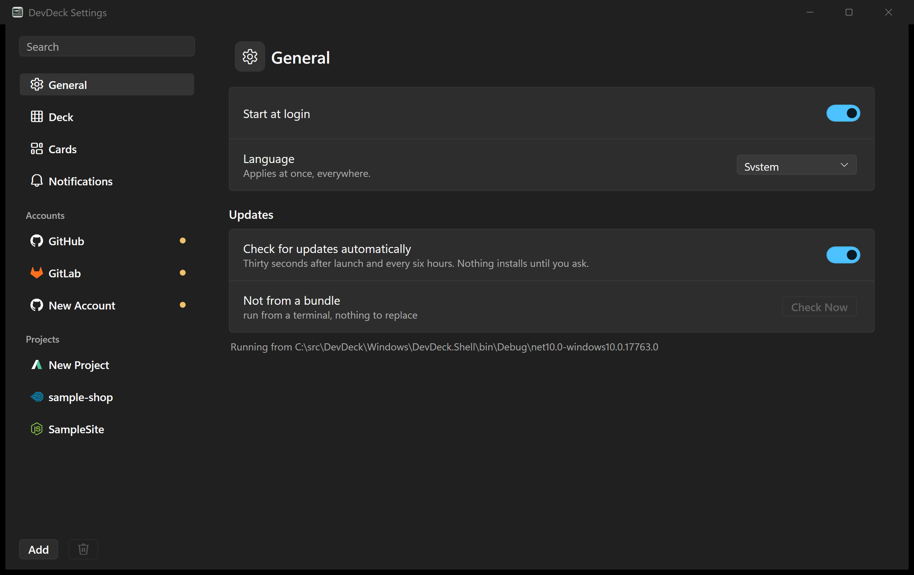

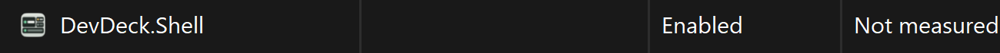

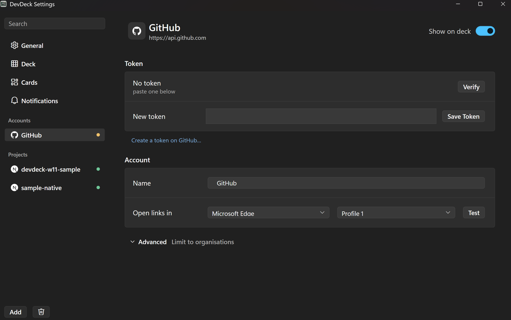

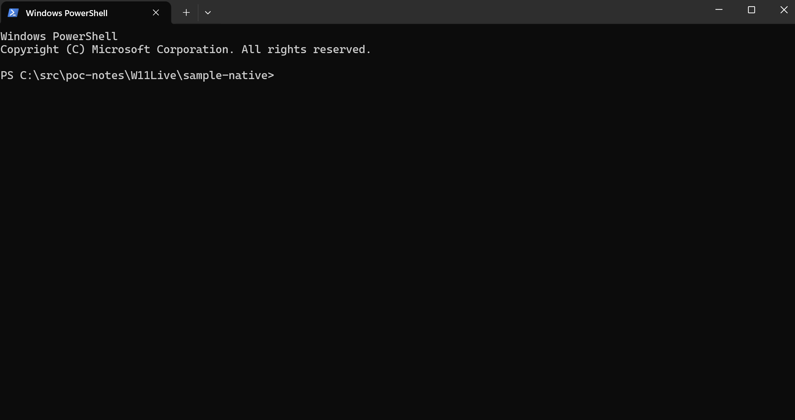

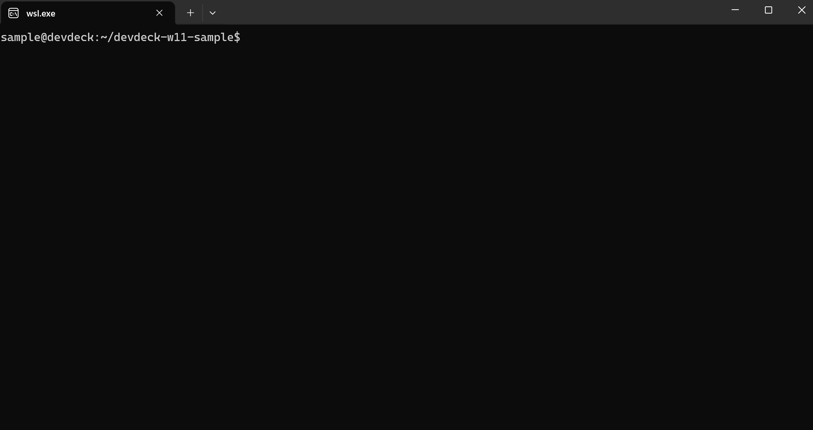

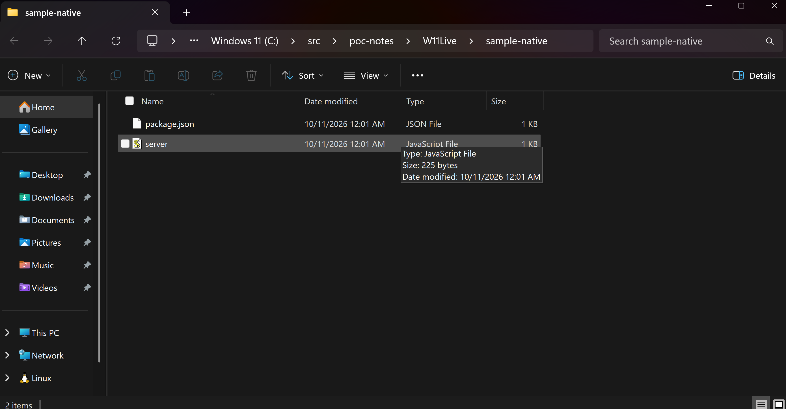

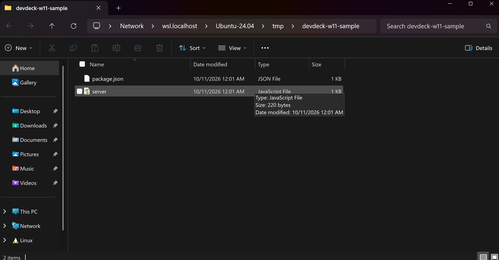

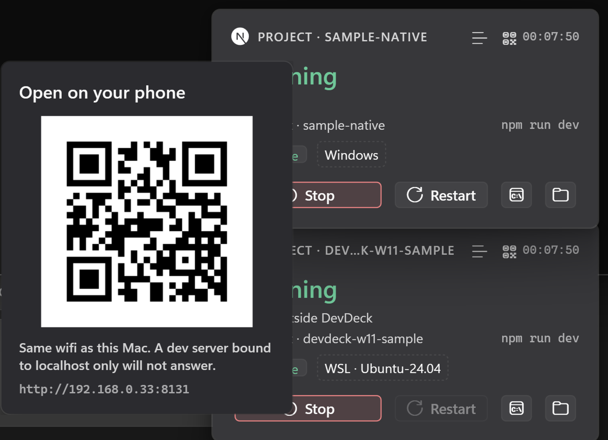

## Current boundary

The shell renders the five card model kinds and collapsed rows, applies `deck.changed` and
`panels.changed`, reports measurements, moves and display changes, executes the supported system
effects and restarts a failed host. It shows the last stopped model and stopped status while the
host is unavailable.

The tray renders `status.changed` and `menu.changed`. A menu update replaces the items in the
open menu without closing its popup. The tray and card menus return engine commands unchanged;
only a prompt fills the command's `name`. `openMenu` opens the tray menu and `quit` closes the
shell after the host stops its cycles. `openSettings` opens the engine backed settings window.

`notify` posts one Windows toast per model with the source mark from `BrandMarks.json`. Quiet
models add the system silent audio flag. A click returns the stored command without changing its
JSON. Notification ids are remembered by the shell so a restarted host cannot show the same
banner twice.

`openLogs` and `closeLogs` manage one resizable log window for each card. The shell returns
`logWindow.changed` for both engine and user initiated changes. Card highlighting still changes
only when the next `card.changed` model carries `header.logIsOn`.

Summon reads its enabled state, dimming choice and Windows shortcut from engine preferences.
The global shortcut and `present` effect raise the existing panels without activating them. A
hold is spring loaded, while a tap, Escape and a veil click use the shared latched state.

All five model kinds and collapsed rows use the Windows visual system in
[`docs/windows-style.md`](../docs/windows-style.md). Review lists cover both GitHub pull requests
and GitLab merge requests. Arc, DDEV, Windows and WSL projects share the project renderer while
keeping their engine supplied marks, chip kinds and actions. The project log control is a 24 px
icon button: `header.logHelp` is its tooltip and `header.logIsOn` is its highlighted state. The
phone icon appears only when the engine supplies `header.phoneURL`; its popup uses the engine
supplied title, note and address.

`installUpdate` downloads and verifies the Windows installer, reports progress and failures to
the engine and launches the quiet per-user update. See [Updates](#updates).

## The Windows scheme

The shell follows Windows the way the taskbar does: the app mode chooses the dark or the light
palette, transparency effects choose Acrylic or a solid surface, and with the accent shown on
Start and the taskbar in dark mode the cards take the taskbar's accent tint. Cards, menus,
dialogs, the log and the settings window redraw when any of these change, without a restart;
the tray icon follows the taskbar's own mode. Cards are drawn in the taskbar's material and take
their text palette from it; windows, menus and dialogs follow the app mode, as any Windows
application does, so with a dark Windows mode and light apps the cards are dark and the settings
window light. Every colour lives in `DeckPalette`, one table per
scheme; views built in code get brushes that keep following it.

To compare the four schemes of the reference mock off screen:

```powershell
dotnet run --project Windows/DevDeck.Shell.Tests -- --capture-theme Tests/EngineTests/Golden/session-en.expected.jsonl C:	emp	heme.png
```

## Terminal selection and Arc launch checks

General has an Application and, for Windows Terminal, a Profile picker. The engine supplies
the group, translated labels, options and selected values. It stores the choice in its normal
preferences. System default keeps the existing behavior: Windows Terminal when installed,
otherwise Command Prompt. Direct Command Prompt, Windows PowerShell and PowerShell are also
offered when installed. Changing the application resets the profile. Profile GUIDs keep a
selection stable when its name changes; hidden profiles are not offered.

Windows Terminal profiles are read from its stable, preview, canary or unpackaged settings file.
Comments and trailing commas are supported. The shell passes a selected GUID with `wt -p`.
WSL paths always open `wsl.exe -d <distribution> --cd <linux path>`, even with a selected
terminal profile. Direct PowerShell starts in the folder through an encoded, quoted command.
This choice only affects Open terminal. Background Windows projects still use cmd.exe, and
WSL projects use their distribution's runner. No execution policy is changed.

The engine checks Arc launch requirements in the project's environment, once per folder and
start command, and again after they change, on Start or Restart, and on Check Now. It checks the
folder and command, Node, npx and the installed local or global `@arc-fusion/cli` binary. It does
not call `npx fusion` during a check and does not download or install dependencies. Missing
requirements appear on the card and the Check Now row; Start and Restart are disabled. Before
either command actually runs, the engine rechecks requirements and Docker. Stop is retained
when the stack is serving. A custom Node start checks Node and its script instead of requiring
Fusion. Other custom shell commands are reported as checked at run time because evaluating
arbitrary shell code during a preflight would itself start work.

See [the verification](../docs/windows/terminal-arc-readiness-report.md). The same check runs on
the Mac. Windows terminal choices do not alter the Mac terminal.

## Docker and DDEV on Windows

Only one live DevDeck shell runs per Windows user session. A second launch starts no host
and shows no window: it signals the running shell, which raises the deck the way the summon
shortcut does, and exits. A replay holds its own instance, so one replay runs at a time next
to the live shell without blocking it or being blocked by it. Developer commands such as
`--add-project` and `--remove-project` remain separate short lived requests outside both.
Quit completes host cleanup asynchronously before shutting down the UI dispatcher.
Tray and card menus close after a command or a click outside the application. Engine
menu updates wait until the current popup closes so input capture remains intact.

The `launchDocker` effect starts `%ProgramFiles%\Docker\Docker\Docker Desktop.exe`
without waiting. The next engine polls supply the progress and card actions.
The shell does not infer Docker state from the desktop process.

Install the native DDEV executable on the Windows user PATH for Windows project folders.
For a WSL folder, install DDEV inside that distribution and enable Docker Desktop's
integration there. The engine selects the runner from the folder, queries each configured
place and presents WSL candidates with their UNC folders. Arc Fusion was checked live
in both places, natively on Docker Desktop and in WSL.

One Fusion stack runs per Docker daemon. Fusion gives every checkout the same compose
project, so two Arc checkouts that reach one daemon replace each other. With Docker
Desktop's WSL integration on, a checkout in WSL and one started from Windows share that
daemon: starting one stops the other, and its card shows stopped. Checkouts that serve on
the same port, 80 by default, also answer each other's health checks. The Arc section of
[docs/cards.md](../docs/cards.md) has the details.

Docker Engine installed inside a distribution, rather than Docker Desktop, has one trap of its
own: WSL stops a distribution that has no process of yours in it, systemd services do not count,
and the containers go down with it. A DDEV project that was running a moment ago shows
`paused` after the next two polls, with the time of the last check on the card in between.
Keep the distribution up with `vmIdleTimeout` in `.wslconfig`, or run Docker Desktop, which
keeps its own distribution alive. The engine does not wake a distribution on its own: the
poll is a question, not a command.

The lifecycle tools also accept `ddev-start`, `ddev-status`, `ddev-stop` and `docker-format`.
See [development.md](../docs/development.md) for separate-process checks.

Live results and real captures are in the [W-12 report](../docs/windows/W12-windows-stacks-report.md).
