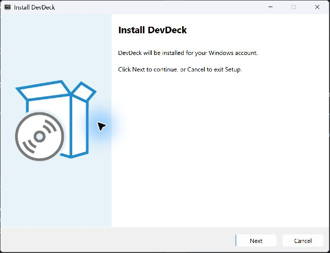
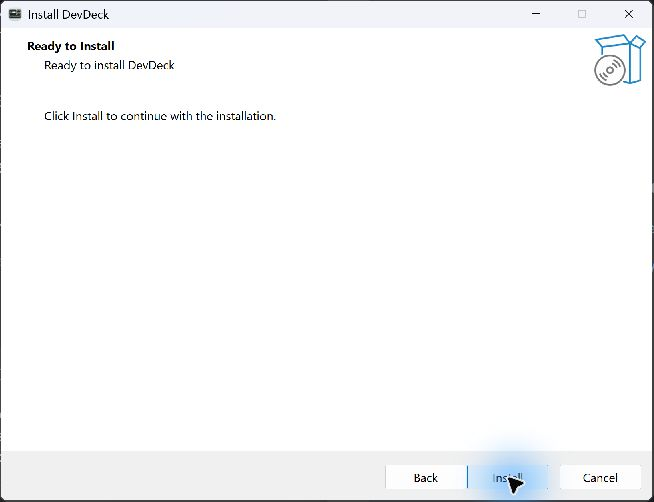
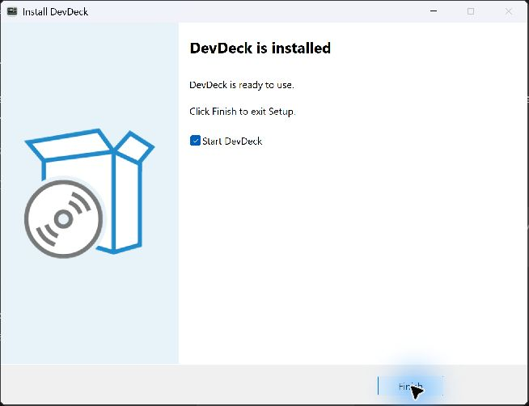
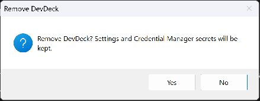
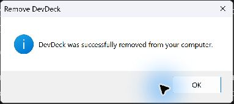

# Windows installer verification

Measured on 2026-10-11 on Windows 11 25H2, build 26200.9457. The branch starts at
main `23a95d5`. The application version comes from the root `VERSION` file: `0.19.2`.
Tools: Swift 6.4 RELEASE with assertions, .NET SDK 10.0.401, Microsoft.WindowsDesktop.App
10.0.12 and Inno Setup 6.7.3.

## Delivery

| Output | Bytes | MiB | Files |
|---|---:|---:|---:|
| Framework dependent delivery | 101970206 | 97.25 | 41 |
| DevDeck-Setup-0.19.2.exe | 23999538 | 22.89 | 1 |

The .NET runtime is not included. Swift runtime DLLs, both Swift hosts and localization
remain in the delivery. The shell and installer are unsigned. The build reads the existing
Mac release version without a second version field. Neither CI nor the release workflow changed.

Build with `pwsh -NoProfile -File Tools/Build-WindowsInstaller.ps1`.
The output path guard rejected a directory outside the repository. ISCC compiled successfully.

## Live checks

| Check | Result |
|---|---|
| Fresh per-user installation | Passed with an existing .NET 10 Desktop Runtime. Default destination, HKCU uninstall registration, no desktop shortcut and no elevation. |
| Interactive completion | Passed. Start DevDeck is checked and starts the installed shell. |
| Silent installation with /NORESTARTAPP | Exit 0, no shell started. |
| Silent update with automatic launch | Exit 0, exactly one new shell. The previous shell and host exited normally. |
| Detached Windows and WSL projects during update | Both returned HTTP 200 after the old host exited and the new shell started. |
| Card positions and Start at login during update | Preserved. The Run value still pointed at the installed executable. |
| Registered version update | 0.19.1 changed to 0.19.2. The older installer had an older version stamp but the same application binaries. |
| Installer shortcut | Target and AUMID DevDeck.Shell matched. Launching the shell and golden notification replay did not rewrite the shortcut. |
| Notifications | A neutral GitHub notification from runtime-banners-en was found in Windows notification history using the installer shortcut. |
| Start at login | Disabled, enabled through --enable-login-item, then disabled. The existing system setting was restored after the checks. |
| Uninstall | Installed folder, Start Menu shortcut, Run value and NotificationAssets were all absent. No restart was needed. |
| Settings and credentials | Existing settings file hashes and cmdkey listing hash were unchanged after uninstall. No token was read or entered. |

The isolated projects were stopped before uninstall. After verification the application was
installed again without starting it. The original Run value was restored. Test ports were free
and the WSL server and saved PID were absent.

During the final fixture cleanup, the engine logged these messages:

```text
project installer-wsl: could not ask WSL for its process: CancellationError()
project installer-wsl: could not ask WSL for its process: WSL command timed out; its cleanup could not be verified
```

The successful update run had an empty host stderr. These later cleanup messages are recorded
without an engine change. Independent checks found no remaining fixture server.

## Installer details

The shell accepts --quit, signals the existing user's live and replay instances, and waits
at most ten seconds. It uses the same asynchronous shutdown as tray Quit. Tests cover flag
parsing, the exit signal and timeout. A legacy shell without this argument must be quit manually.

Restart Manager originally included detached project hosts and stopped the native fixture.
Its filter now includes only DevDeck.Shell.exe and DevDeckEngineHost.exe. Identical DLLs and
DevDeckProcessHost.exe are skipped using SHA256 comparisons with the packaged files. This avoids
replacing files still loaded by detached projects. Replacing a changed, loaded runtime or process
host was not checked and can still fail due to a file lock; stop projects before that update.

Reading the installer shortcut required support for both BSTR and LPWSTR property values and
the 24 byte x64 PROPVARIANT layout. The native shortcut test covers reading its identity and
keeping matching shortcut bytes and modification time unchanged. The actual Inno shortcut was
also checked on this machine.

The missing runtime path checks both registry views, downloads Microsoft's permanent URL and
asks for elevation only to install that runtime. No fixed checksum is pinned because the URL
tracks Microsoft's servicing releases. Download errors report the link and stop installation.
This path, its UAC request and download failure UI were not exercised: .NET 10 was already
installed, and no separate account without the shared runtime was available. The system runtime
was not removed. SmartScreen behavior was not exercised on a downloaded installer.

## Build and tests

| Check | Result |
|---|---|
| Windows swift build | Passed, no project warnings. |
| DevDeckWindowsCoreTests | 15 passed, 0 failed. |
| DevDeckEngineTests | 26 passed, 0 failed, committed goldens unchanged. |
| dotnet build Release -warnaserror | 0 warnings, 0 errors. |
| DevDeck.Shell.Tests | 98 passed, 0 failed. |
| Sources, csproj, CI and release workflow | Unchanged. |

Mac build and tests were not run. The known Swift WinSDK warning remains an external toolchain
issue; it was not emitted in this incremental Windows build.

## Real installer captures

These are native window captures, not rendered composites. No project or account data is shown.






