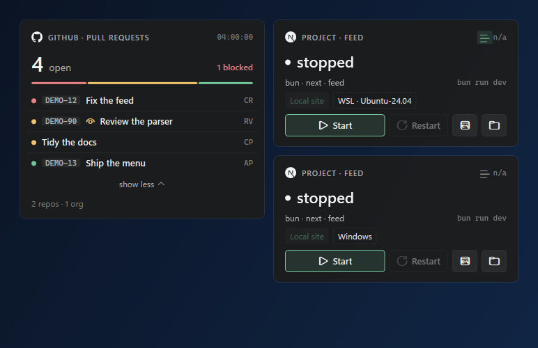

# Windows ARM64 verification

The branch starts at main `23e95cec8d1b664b1f0aec5628d55e461747a270`.
Verification date: 2026-10-12.

## Machine and tools

The machine is a Microsoft Surface Laptop, 7th Edition with an ARM64 processor. It runs
Windows 11 Home 25H2, build 26200.9457.

| Tool | Version |
|---|---|
| Git for Windows | 2.51.0, `core.autocrlf=false` |
| Swift | 6.2.4 RELEASE with assertions, target `aarch64-unknown-windows-msvc` |
| .NET SDK | 10.0.401 ARM64, runtime 10.0.12 |
| Visual Studio | Community 2022 17.14.41, MSVC v143 ARM64 and Windows SDK 10.0.22621.0 |
| Inno Setup | 6.7.3 |
| PowerShell | 7.6.5 |
| Docker Desktop | 4.47.0, client and Linux engine 28.4.0 ARM64 |
| WSL | 2.7.14.0, Ubuntu 24.04.3 ARM64 |
| DDEV in WSL | 1.24.10 ARM64 |
| Node.js in WSL | 24.21.0 LTS ARM64, npm 11.19.0 |

Swift 6.4.0 ARM64 and 6.3.3 ARM64 crashed during process startup in `mimalloc.dll` on this
machine. The nearest usable official ARM64 toolchain is Swift 6.2.4. It also requires
`MIMALLOC_DISABLE_REDIRECT=1` on this Windows build. These are host toolchain limitations, not
repository changes.

## Build and test results

The clean baseline was taken from a tracked-source snapshot at `C:\src\DevDeck` before changes.

| Check | Result |
|---|---|
| `swift build --jobs 1` | Passed on ARM64 with no compiler warnings. |
| `DevDeckWindowsCoreTests` baseline | 17 passed, 0 failed. |
| `DevDeckEngineTests` baseline | 40 passed, 0 failed; every golden transcript matched. |
| .NET Release build with `-warnaserror` | Passed with 0 warnings and 0 errors. |
| `DevDeck.Shell.Tests` baseline | 113 passed, 0 failed. |
| Updated `DevDeckWindowsCoreTests` | 19 passed, 0 failed; logged `compiled=arm64, Windows=ARM64` and selected the ARM64 update asset. |
| Updated `DevDeckEngineTests` | 40 passed, 0 failed; every golden transcript still matched. |
| Workflow validation | PyYAML and actionlint 1.7.12 passed. |

SwiftPM completed builds successfully but emitted Win32 error 1314 while creating its
`.build\debug` and `.build\release` convenience symbolic links. Developer Mode is disabled and
this account cannot change that setting without elevation. The repository warning gate remains
strict and does not allow this diagnostic. Delivery validation used a disposable staging copy
whose warning filter excluded only this known host diagnostic. The committed builder still allows
only the documented WinSDK `wchar_t` warning.

## Delivery

`Build-WindowsShell.ps1 -Architecture arm64` selected the installed ARM64 Swift target, used
`win-arm64`, and wrote `dist\windows-arm64`. SwiftPM names its product directory
`aarch64-unknown-windows-msvc\release` with Swift 6.2.4. The builder accepts that layout and the
Swift 6.4 `out\Products\Release-windows-*` layout, while requiring the directory to match the
requested target architecture.

| Artifact | Files | Bytes | MiB |
|---|---:|---:|---:|
| ARM64 delivery | 27 | 105,992,566 | 101.082 |
| `DevDeck-0.20-windows-arm64-setup.exe` | 1 | 24,001,494 | 22.890 |

All delivered executables report PE machine `0xAA64`: `DevDeck.Shell.exe`,
`DevDeckEngineHost.exe`, `DevDeckProcessHost.exe`, and `DevDeckMCP.exe`.

Delivered runtime DLLs are `_FoundationICU.dll`, `BlocksRuntime.dll`, `dispatch.dll`,
`Foundation.dll`, `FoundationEssentials.dll`, `FoundationInternationalization.dll`,
`FoundationNetworking.dll`, `MSVCP140.dll`, `swift_Concurrency.dll`, `swift_RegexParser.dll`,
`swift_StringProcessing.dll`, `swiftCore.dll`, `swiftCRT.dll`, `swiftDispatch.dll`,
`swiftWinSDK.dll`, and `VCRUNTIME140.dll`. The framework dependent shell also carries
`Microsoft.Windows.SDK.NET.dll`, `QRCoder.dll`, `WinRT.Runtime.dll`, and `DevDeck.Shell.dll`.

The x64 baseline in `docs/windows-delivery-size.md` is 261.966 MiB and includes a much larger
single-file shell. The current framework dependent ARM64 output is 160.884 MiB smaller; this is a
publishing-layout difference as well as an architecture difference, so it is not an architecture
only size comparison.

## Live checks

| Scenario | Result |
|---|---|
| ARM64 delivery contents and PE headers | Passed. All required products, VERSION and runtime files are present; all EXEs are native ARM64. |
| Native shell and engine startup | Passed with an isolated `LOCALAPPDATA`. The shell started its delivery-local engine and both quit through `--quit`. |
| Cards, settings, tray, log, notification, Summon and light/dark theme | Partly checked. The native processes started, and a neutral ARM64 renderer capture was produced. Interactive UI coverage was not completed because the automation surface did not expose the shell's non-activating windows. |
| Windows, WSL, DDEV and Arc project Start, health, log and Stop | Not completed. Docker, DDEV and Node ARM64 prerequisites are present. |
| ARM64 installer build | Passed. Inno Setup compiled the architecture-specific runtime URL, registry key and filename. |
| ARM64 installer install, update and uninstall | Not completed. The machine has no machine-wide ARM64 Desktop Runtime 10, so the next step invokes a UAC runtime installation that requires a user action. |
| x64 installer refusal | Passed for the new rule. An x64 build of the same Inno script exited before creating its isolated target directory on ARM64. |
| Published v0.20 x64 installer refusal | Not run. v0.20 uses `ArchitecturesAllowed=x64compatible`, which Inno documents as allowing x64 emulation on ARM64. Running it would install instead of proving the expected refusal. W-19 changes the x64 rule to `x64compatible and not arm64`. |
| ARM64 update asset | Passed in native Windows Core tests. Explicit x64 and ARM64 selection is also covered in `UpdateTests.swift`; hosted Mac execution remains pending. |
| Full local update download and relaunch | Not completed; no ARM64 release asset exists yet. |
| MCP through Claude Code | Not completed. No token was entered or logged. |
| x64 delivery under emulation | Not completed; no unpacked x64 delivery was available locally. |

The neutral card capture was rendered by the ARM64 shell test binary from the existing golden
model. It contains no account, token or real project data:

Settings and installer screenshots are still pending with the interactive checks above.

## CI and release behavior

GitHub documents `windows-11-arm` as a standard hosted ARM64 runner. The pinned
`compnerd/gha-setup-swift` action supports `build_arch: arm64` and the official Swift 6.4 ARM64
download layout. Tests and release now share `.github/actions/windows-build`. The release workflow
keeps the existing x64 filename and adds
`DevDeck-<version>-<build>-windows-arm64-setup.exe` with its SHA256 file. A hosted dry run has not
yet been recorded.

## Source scope and limits

The only production file changed under `Sources` is
`Sources/DevDeckCore/Update/UpdateCheck.swift`. Shell product code did not change. Build scripts,
the installer definition, tests, workflows and Windows documentation carry the remaining changes.

Mac tests were not run locally and are not claimed. The pending interactive items above need a
follow-up after Developer Mode and the machine-wide ARM64 .NET Desktop Runtime are enabled.
